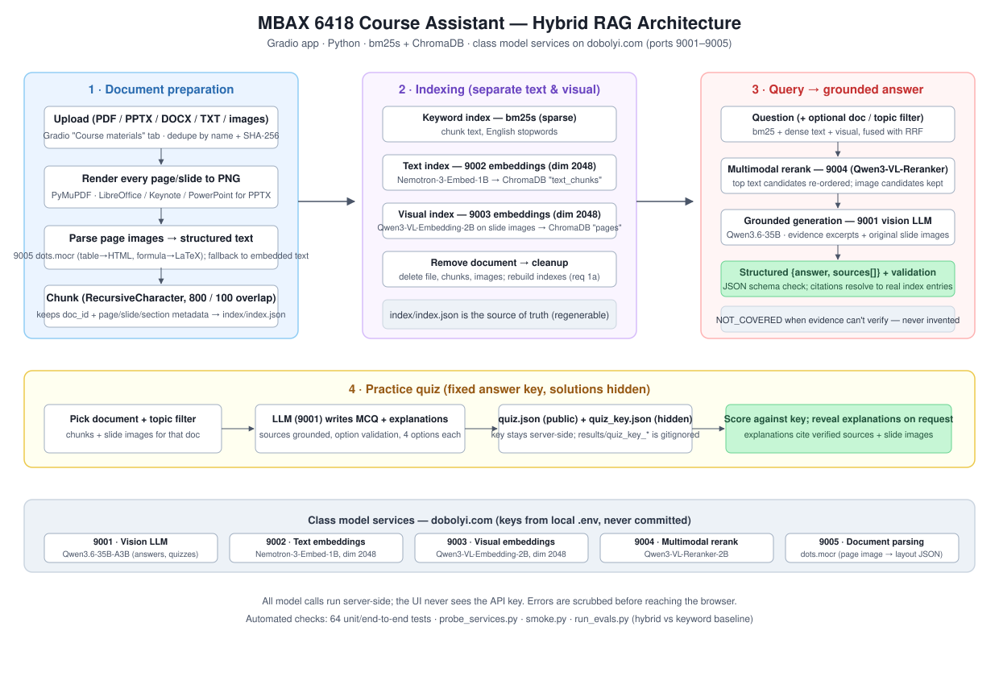
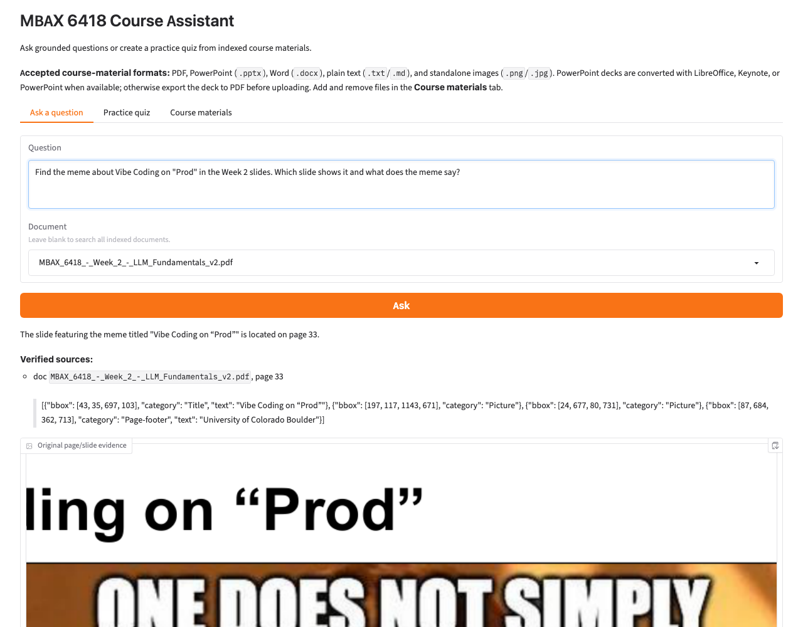
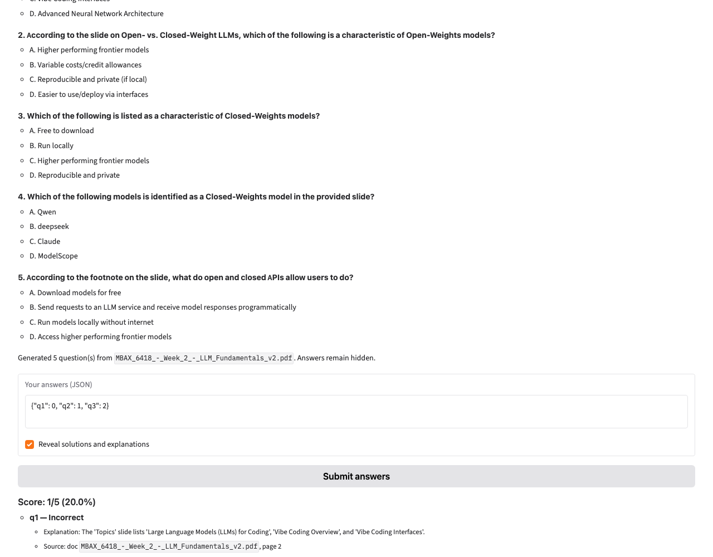
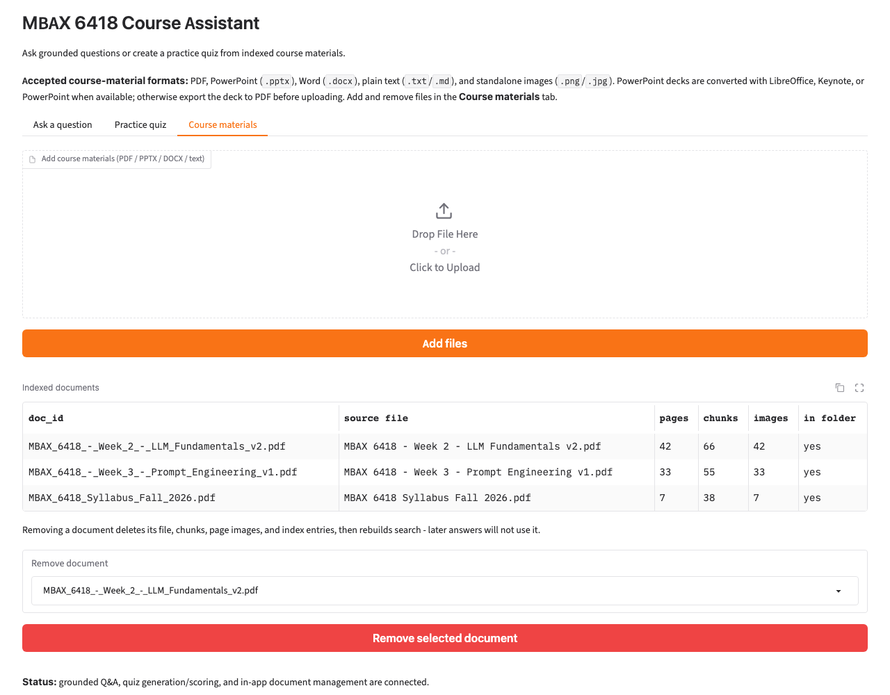
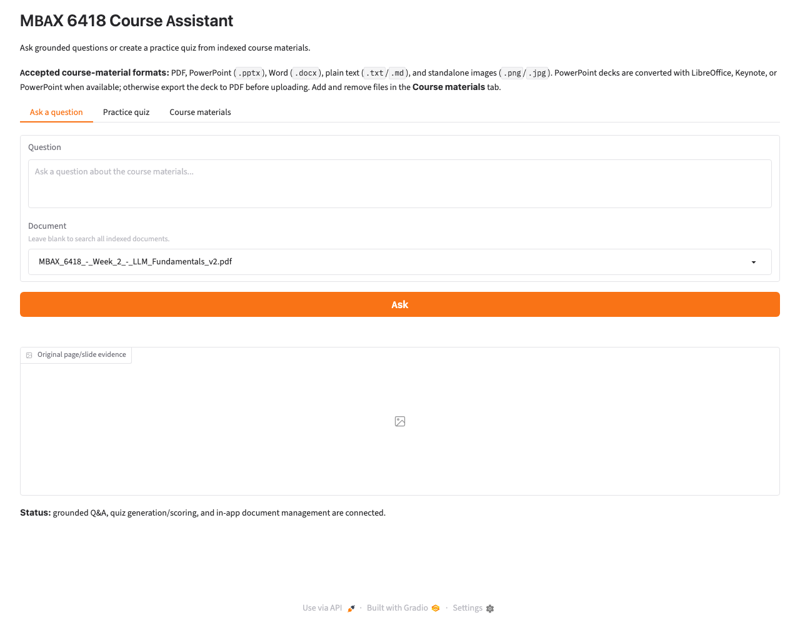
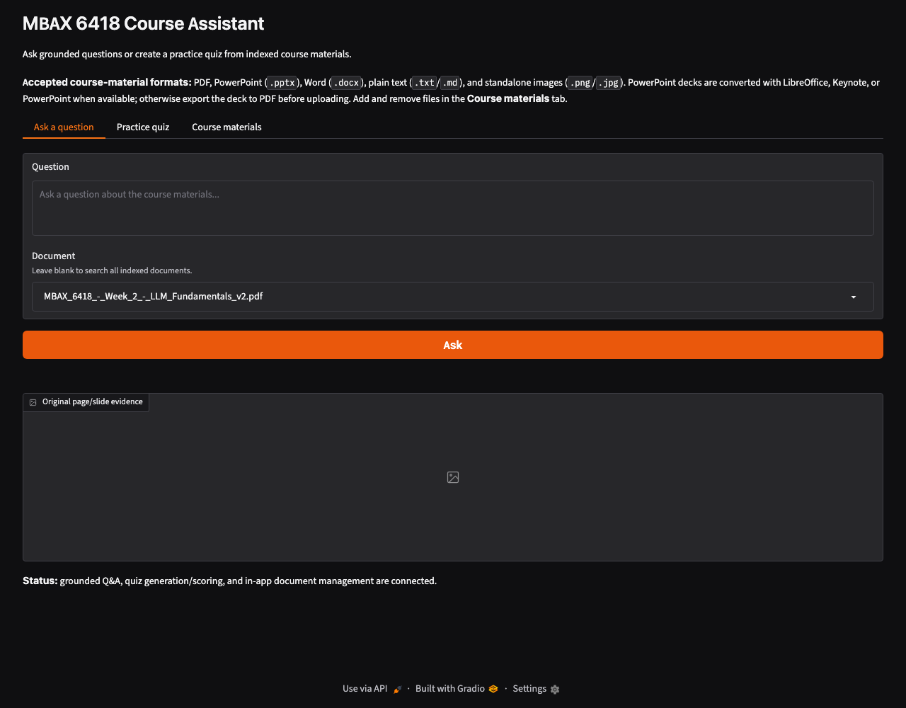

# MBAX 6418 — Assignment 2: Course Assistant

A course assistant that answers questions and generates practice quizzes from course materials (slides, syllabus, readings). Built with **hybrid RAG**: keyword search (bm25s) + text embeddings + visual embeddings over page/slide images, fused and re-ranked, with answers grounded in verified sources and original slide images.

## What it does

| Feature | How it works |
|---|---|
| **Ask grounded questions** | Hybrid retrieval (keyword + text + visual, separate text/visual indexes) → RRF fusion → multimodal rerank → vision LLM generates a structured `{answer, sources[]}` reply. Every claim cites a real indexed chunk or original page/slide image; sources are validated against the index, so citations cannot be fabricated. Missing information returns `NOT_COVERED` — never invented. |
| **Show slide evidence** | Retrieved page/slide images are displayed in a gallery next to the answer, labeled with document name and page/slide number. The user can also ask the app to describe/explain slide content, including diagrams and charts. |
| **Practice quizzes** | Pick a document (optional topic filter) → an N-question multiple-choice quiz grounded in that material's chunks and images. The answer key stays server-side (`quiz_key_*.json`, gitignored); students see scores immediately, and solutions/explanations with sources only after answering or on explicit request. |
| **Manage materials in-app** | Add/remove documents through the UI (requirement 1a). Uploads are deduplicated by filename and content hash; removing a document also removes its chunks, page images, and index entries, so later answers never rely on removed material. |

## Architecture



The pipeline, matching the diagram:

1. **Document preparation** — uploaded files are rendered to a PNG per page/slide (PyMuPDF for PDF; LibreOffice, macOS Keynote/PowerPoint, or Windows PowerPoint COM for PPTX), parsed into structured text by the class document-parsing service (9005), and chunked with `langchain-text-splitters` (800 chars, 100 overlap) while preserving `doc_id` + page/slide/section.
2. **Indexing** — text chunks go into **bm25s** (keyword) and ChromaDB `text_chunks` (9002 text embeddings, dim 2048); page/slide images go into a **separate** ChromaDB `pages` collection (9003 visual embeddings, dim 2048). `index/index.json` is the source of truth and is regenerable.
3. **Query** — bm25 + dense-text + visual retrieval are combined with RRF (k=60), text candidates are re-ranked by the 9004 multimodal reranker, and the best text excerpts **plus original slide images** are given to the 9001 vision LLM with strict evidence-only instructions.
4. **Validation** — the model must return `{answer, sources[]}`; the schema is checked and each cited source must resolve to a real indexed chunk (excerpts come from the index, not the model). Quiz questions and explanations are grounded the same way.

## Class services (do NOT use port 9000 — reserved for Hermes)

| Port | Service | Model | Used for |
|---|---|---|---|
| 9001 | Vision LLM (`/v1/chat/completions`) | cyankiwi/Qwen3.6-35B-A3B-AWQ-4bit | answers, quiz generation |
| 9002 | Text embeddings (`/v1/embeddings`, dim 2048) | nvidia/Nemotron-3-Embed-1B-BF16 | text chunks + query vectors |
| 9003 | Visual embeddings (`/embeddings` — no `/v1` prefix, dim 2048) | Qwen/Qwen3-VL-Embedding-2B | slide/page images |
| 9004 | Multimodal rerank (`/v1/rerank`) | Qwen/Qwen3-VL-Reranker-2B | re-order fused text candidates |
| 9005 | Document parsing (`/chat/completions`, dots.mocr) | dots.mocr | page image → layout JSON |

All calls are server-side. **Port 9000 is reserved for the Hermes agent and must not be used by this app.** Service clients live in `services.py`; they scrub error messages so the API key never appears in logs, the UI, or error output.

## Setup

Requirements: **Python 3.11+** (or later), and — only for direct PowerPoint uploads — **LibreOffice** (recommended) or PowerPoint/Keynote (macOS). See *Supported formats* below.

```bash
# 1. Clone
git clone https://github.com/krisblair82-pixel/assignment-2.git
cd assignment-2

# 2. Virtual environment + dependencies
python -m venv .venv            # or: uv venv .venv
source .venv/bin/activate       # Windows: .venv\Scripts\activate
pip install -r requirements.txt

# 3. Configure the class API key (NEVER commit this file)
cp config.example .env
#    edit .env and set CLASS_API_KEY=<your real class key>
#    .env is gitignored; config.example holds dummy values only

# 4. Activate the pre-commit secret scanner (blocks any commit containing
#    a value from .env or a known secret pattern)
git config core.hooksPath scripts/hooks

# 5. Verify connectivity, then add materials
python probe_services.py        # checks all 5 services (scrubbed output)
python smoke.py                 # live smoke: embed / rerank / chat / parse
python ingest.py                # parse + chunk everything in materials/
python retrieval.py build       # build bm25 + text + visual indexes
python run_evals.py             # 16-question evaluation suite (hybrid)
```

### Supplying API keys without committing them

- All keys live in a local **`.env`** file (gitignored via `.gitignore`, and enforced by the pre-commit scanner in `scripts/hooks`).
- `config.example` contains **dummy values only** — never put real keys there.
- The app reads `.env` through `config.py`; base URLs point at `dobolyi.com` by default (edit to `localhost` only if you tunnel the ports).
- Keys must never appear in code, the UI, logs, errors, screenshots, docs, test results, or GitHub issues/PRs — the secret scanner fails the commit if one does.

## Launching the app

```bash
python app.py          # opens http://127.0.0.1:7860
```

Three tabs:

1. **Ask a question** — optional document filter; the answer panel shows verified sources with real excerpts, and a gallery shows the original page/slide images that support the answer.
2. **Practice quiz** — pick a document (+ optional topic phrase), choose 1–10 questions, answer in JSON (`{"q1": 0, "q2": 2}`), get scored, then reveal solutions/explanations with sources when ready.
3. **Course materials** — add files (multiple at once) or remove documents. Adding runs parsing + indexing for that file; removing deletes the file, its chunks, page images, and index entries, then rebuilds search indexes.

### Supported formats and PowerPoint conversion

| Format | Notes |
|---|---|
| `.pdf` | text + page images (best supported) |
| `.pptx` | text via python-pptx; slide images via **LibreOffice** (recommended, headless) — or on macOS via **Keynote**/**PowerPoint** (opens briefly), or Windows PowerPoint COM |
| `.docx` | text with heading sections |
| `.txt` / `.md` | plain text |
| `.png` / `.jpg` / `.jpeg` | standalone image (queried visually) |

If no converter is available, ingestion warns and indexes the deck **text-only**; the manual workaround is exporting the deck to PDF (acceptable per the assignment) and uploading the PDF instead.

## Testing

```bash
python -m pytest -q        # 52 tests: unit + end-to-end + secret scan (see tests/)
python run_evals.py        # hybrid: full retrieval + grounded answers over the 16-question set
python run_evals.py --mode keyword   # issue #5 baseline: bm25 keyword search only
```

What is tested: adding/removing files (dedupe, index cleanup), answering text and image questions, quiz generation/scoring (answer keys stay hidden), missing-information handling, repeated uploads, unavailable services (resilient leg fallback), light/dark mode readability (Gradio themes), and the secret scanner. What remains unchecked: fresh installs on Windows hardware (COM rendering) and macOS Keynote conversion — see *Limitations*.

Screenshots are reproducible: `python -m playwright install chromium && python scripts/capture_screenshots.py` (requires the app running; re-generates `assets/screenshots/*.png`).

## Evaluation results and design comparison (issue #5)

Question set: 16 gold questions in `results/eval_questions.json` covering Week 2 slides (text + visuals, including the required **Vibe Coding on "Prod"** meme on slide 33), Week 3 Prompt Engineering slides, the syllabus, plus one intentionally unanswerable question (q12) to check that the app acknowledges missing information. Both modes ran on the same questions and the same index; transcripts are saved in `results/eval_*.json` (the two latest runs are the comparison below; earlier transcripts document the iteration, including a metrics bug where expectations written for the original PPTX index used slide numbers — page/slide-twin expectations were added when the materials switched to PDF).

**Hybrid (all legs + rerank) vs keyword-only baseline (bm25 only), 16 questions:**

| Metric | Hybrid | Keyword-only baseline |
|---|---|---|
| Retrieval source-hit | 15/16 | 15/16 |
| Grounded answers | 16/16 | 15/16 |
| NOT_COVERED handled correctly | 1/1 | 1/1 |
| Total time | 136.5s | 88.8s |
| Avg time per question | 8530 ms | 5547 ms |

Per-question retrieval source hits (hybrid then keyword):

| Question | Hybrid hit | Hybrid time | Keyword hit | Keyword time |
|---|---|---|---|---|
| q01_open_weights | ✅ | 8.5s | ✅ | 9.4s |
| q02_training_data | ✅ | 5.6s | ✅ | 4.5s |
| q03_model_size | ✅ | 10.7s | ✅ | 9.1s |
| q04_context_window | ✅ | 6.4s | ✅ | 4.7s |
| q05_prompt_caching | ✅ | 9.2s | ✅ | 4.8s |
| q06_quantization | ✅ | 6.8s | ✅ | 4.1s |
| q07_moe | ✅ | 5.4s | ✅ | 4.5s |
| q08_vibe_vs_agentic | ✅ | 8.4s | ✅ | 5.6s |
| q09_interface_choice | ✅ | 5.3s | ✅ | 3.5s |
| q10_mcp_visual | ✅ | 8.9s | ✅ | 5.0s |
| q11_open_closed_visual | ✅ | 6.5s | ✅ | 4.9s |
| q12_not_covered | n/a | 5.5s | n/a | 4.1s |
| q13_meme_prod | ✅ | 27.8s | ✅ | 10.3s |
| q14_syllabus_grading | ✅ | 9.9s | ✅ | 4.9s |
| q15_syllabus_office_hours | ✅ | 6.4s | ✅ | 4.7s |
| q16_week3_prompts | ✅ | 5.2s | ✅ | 4.4s |

**Interpretation:** retrieval *location* is equally good in both modes (15/16 — the miss is the deliberate not-covered case), and keyword-only is ~35% faster because it skips embedding and reranking calls. But hybrid grounded **all 16** answers while keyword-only grounded **15** — it fails q14, the syllabus-grading question, because the grading table is parsed as HTML and keyword search matches table markup poorly; the dense text leg retrieves the right chunk by meaning. Critically, keyword-only retrieval cannot return *page/slide images*: the visual leg is what lets the app **show the actual meme slide** (q13) and diagram images, which the assignment explicitly requires. We keep the full hybrid pipeline: the extra ~3 seconds per question buy visual evidence and stronger grounding on table-heavy material.

Regression: `scripts/make_comparison_table.py` regenerates these tables from the latest transcripts (`python scripts/make_comparison_table.py`).

## Known limitations and failures investigated

(Written up from the actual runs — see commit history and `results/`.)

- **Slide rendering needs a local office suite.** LibreOffice is the robust headless path; macOS falls back to Keynote/PowerPoint which briefly open a GUI window, and decks upload text-only if neither is present. Manual PDF export is the documented workaround.
- **Visual retrieval quality depends on the 9003 service.** Image-carrying candidates are kept separate from the reranked text list; the reranker currently scores text-only document strings (the service's verified input shape).
- **Large decks are slow in the UI.** Parsing a 40+ slide deck through 9005 takes minutes (one call per page); uploads show a status message rather than a progress bar.
- **`index/` is regenerable, not authoritative.** Removing a document rebuilds bm25 + chroma from `index/index.json`; a corrupted index dir is fixed by re-running `ingest.py` + `retrieval.py build`.
- **Reasoning-model quirk (9001).** The chat model emits a `reasoning` field that can consume the token budget; clients double the budget and retry once when `content` comes back empty.
- **Boundary questions are occasionally flaky.** The meme question (q13) sits near the NOT_COVERED boundary; the same question sometimes returns `NOT_COVERED (could not parse a structured answer)` with a slightly different phrasing or run, even though the eval harness passes it 15/16+ consistently. The app fails closed (never invents), and re-asking typically returns the grounded answer. The screenshot script retries up to 3 times for this reason; a future improvement could add an automatic single retry inside `ask()` when the model returns an unparseable response.
- **Port 9000 is off-limits.** Reserved for Hermes; this app only uses 9001–9005 (per the connectivity report `connectivity_report.md`).

## Security notes

- API key lives in gitignored `.env`; examples use dummy values.
- Pre-commit hook `scripts/hooks/pre-commit` runs `scripts/scan_secrets.sh`, which scans staged content for `.env` values and secret patterns.
- Browser UI shows scrubbed error messages only; CLI scripts print scrubbed diagnostics.
- Quiz answer keys (`results/quiz_key_*.json`) are gitignored and never rendered by the UI.
- Course materials (`materials/`) are gitignored — they are copyrighted and stay out of the repository.

## Repository map

| File | Purpose |
|---|---|
| `app.py` | Gradio interface (Ask / Practice quiz / Course materials) |
| `services.py` | Class API clients (9001–9005), scrubbed errors |
| `ingest.py` | Render → parse → chunk pipeline; per-file `process_file()` |
| `retrieval.py` | bm25 + dense text + visual retrieval; RRF fusion; rerank; selectable legs |
| `answers.py` | Grounded answer generation + source/grounding validation |
| `quiz.py` | Quiz generation (public quiz + hidden key) and scoring |
| `documents.py` | In-app add/remove of materials (dedupe, index cleanup) |
| `run_evals.py` | 16-question eval suite, hybrid vs keyword baseline, timings |
| `probe_services.py` / `smoke.py` | Connectivity and live-service smoke checks |
| `config.py` / `config.example` | `.env` loading (dummy values in example) |
| `scripts/scan_secrets.sh` | Pre-commit secret scanner |
| `tests/` | Unit + end-to-end tests |
| `results/` | Committed evidence: eval transcripts, smoke reports, inventories |
| `assets/architecture.svg` | Architecture diagram (embedded above) |

## Glossary

- **RAG (Retrieval-Augmented Generation)** — fetching relevant source text/images first, then asking the model to answer using only that evidence.
- **Hybrid retrieval** — combining multiple search methods (here: keyword + text embeddings + visual embeddings) instead of relying on one.
- **Embedding** — a dense numeric vector that captures meaning; similar texts/images get similar vectors.
- **Visual embedding** — an embedding computed from an image (here, a page/slide render) so images can be searched by meaning.
- **BM25 / bm25s** — classic keyword ranking (term-frequency statistics); `bm25s` is a fast Python implementation.
- **RRF (Reciprocal Rank Fusion)** — merging ranked lists from different search methods by their ranks.
- **Reranker** — a model that re-scores candidate passages against the query for a more accurate final ordering.
- **Chunk** — a slice of a document's text (~800 chars here) that is embedded and searched independently.
- **Grounding** — ensuring the answer's claims and citations trace back to the actual source material.
- **NOT_COVERED** — the app's structured way of saying the materials cannot answer the question.
- **doc_id** — a document's stable identifier in the index (slugified relative path, e.g. `MBAX_6418_Syllabus_Fall_2026.pdf`).
- **Answer key** — the correct-answer map for a quiz; kept out of the app UI and out of git.

## Team workflow

Substantial tasks are tracked as GitHub issues with completion checklists; work lands via branches and pull requests (see the issues and PR history). Everyone on the team reviews a teammate's work before merging. Screenshots: an answer with a supporting slide image and quiz feedback with sources are included in this README (see below).

## Screenshots

**Grounded answer with the original supporting slide image** — the required Week 2 "Vibe Coding on Prod" meme test: the app identifies slide 33, verifies the source, and shows the actual slide (with the Boromir "One does not simply…" meme) in the evidence gallery.



**Quiz feedback with sources** — after submitting answers, scores match the fixed answer key; solutions stay hidden until the student requests them, then explanations appear with verified source references (document + page/slide).



**Course materials tab** — in-app document management (add/remove, dedupe, index cleanup).



**Light and dark modes** — the Gradio default theme follows the system color scheme; both were checked for readability of text, controls, and source images (`assets/screenshots/ask_tab_light.png` and `ask_tab_dark.png`). No readability issues found; the slide images render identically in both themes.

Light|Dark
---|---
|
